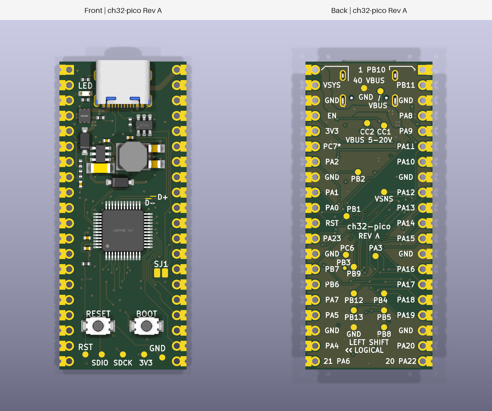

# ch32-pico

A tiny RISC-V dev board in the Pico's footprint, with USB-C, 37 GPIOs and
USB Power Delivery you control from your own code. Built by Left Shift
Logical around the WCH CH32X035.



## Why you might want one

- **Plug in and program.** The chip's factory USB bootloader loads your
  application straight over USB-C. No programmer, no adapter.
- **Ask your charger for more.** The CH32X035 speaks USB-PD natively. Your
  firmware can request 5, 9, 12, 15 or 20 V from a PD supply, and that voltage
  appears on pin 40 for whatever you're driving.
- **Plenty of pins.** 26 GPIOs on the headers with UART, I2C, SPI, PWM and
  three ADC inputs, plus ten more on pads underneath, including op-amp and two
  extra ADC inputs.
- **Fits where a Pico fits.** Same 21 × 51 mm outline, same 40 header
  positions, castellated edges for soldering straight onto a carrier.
- **See what it's doing.** Labelled probe pads for VBUS, the CC lines, USB data
  and the LED, and a RESET and BOOT button on the bottom edge.
- **Open.** MIT-licensed software, CERN-OHL-P hardware, and the whole design
  is Python you can read and regenerate.

## Read this before you connect anything to pin 40

Pin 40 is the USB VBUS rail, exactly as on the Pico. It's 5 V when you plug in,
and it stays 5 V unless your firmware asks the supply for more. If it does, pin
40 carries that higher voltage, up to 20 V, with nothing in between to stop it.
So:

- Only request a voltage your carrier board can take.
- Don't feed power into pin 40 while a USB cable is connected.
- A short on pin 40 relies on your charger's protection, not the board's.

Pin 39 (VSYS) is still a 4.3–5.5 V input and pin 36 is still a fixed 3.3 V
output, so a plain 5 V Pico carrier works as long as your firmware leaves the
PD voltage alone.

## A few pins are different from the Pico

| Pin | On a Pico | Here |
|---|---|---|
| 35 | ADC_VREF | Not connected until you bridge solder jumper SJ1 (front, below the chip); then it's PC7 |
| 37 | 3V3_EN | Pull low to switch the 3.3 V regulator off |
| 40 | VBUS, 5 V | VBUS, 5 V or whatever PD voltage you negotiate |

The GPIO labels on the back use the chip's own names (PA0, PB10, …), not Pico
GP numbers. The full pinout and peripheral map are in the
[design notes](docs/design.md#header-allocation).

## Where things stand

This is a prototype. The design passes every automated check we have, but no
boards have been built yet, so the 3 A power target, the USB-PD application
firmware and the thermal and surge behaviour are all unverified. Treat it as a
board to build and test, not one to put in a product. Open items are tracked in
the [qualification plan](docs/power-qualification.md).

## Build your own

With `uv`, `just` and KiCad 10 installed:

```sh
just jlcpcb
```

That checks the design and produces the Gerbers, BOM and placement file for a
JLCPCB order of twenty boards. See [build instructions](docs/build.md) and the
[manufacturing notes](docs/manufacturing.md) for details and the parts that
are hard to source right now.

## Learn more

- [Design, pinout and limits](docs/design.md)
- [Power qualification plan](docs/power-qualification.md)
- [PD firmware policy](firmware/pd/README.md)
- [Parts and factory review](docs/factory-review.md)
- [Licensing](docs/licensing.md)

Software: [MIT](LICENSES/MIT.txt). Hardware:
[CERN-OHL-P-2.0](LICENSES/CERN-OHL-P-2.0.txt).
